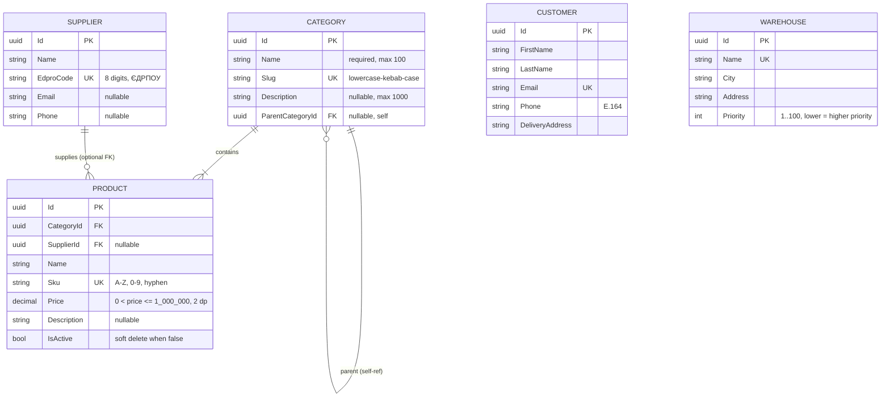

# ERD предметної області (Online Store / Warehouse)

Спільна діаграма сутностей для команди **team-05-store**.

| Джерело | Призначення |
|---------|-------------|
| [TZ.md](TZ.md) §2.2–2.3 | Повна предметна область і зв’язки |
| GitHub issue **#5** | Обов’язковий мінімум для S1 (ЛР1) |
| Issues S2–S8 | REST-контракти, EF, розширення моделі |

Діаграму **оновлюють у PR**, де змінюється модель даних (міграції EF, нові зв’язки). У таких задачах у Acceptance Criteria часто є пункт «ERD оновлено».

---

## Діаграма S1 (закриває issue #5)

П’ять базових сутностей каталогу та довідників. Зв’язки **Category → Product** і **Supplier → Product** узгоджені з TZ §2.3 і майбутніми задачами #30, #31.



### Зв’язки S1

| Зв’язок | Кардинальність | Delete / примітка |
|---------|----------------|-------------------|
| Category → Category (parent) | 1:N (дерево) | Цикл заборонений (#43); видалення з дітьми або товарами → 409 (#9) |
| Category → Product | 1:N | **Restrict** — категорію з товарами не видаляють (#30) |
| Supplier → Product | 1:N, FK nullable | **SetNull** на `Product.SupplierId` (#31) |
| Customer | ізольовано на S1 | Зв’язок **Customer → Order** — S4 (#45) |
| Warehouse | ізольовано на S1 | Зв’язок через **Stock** — S4 (#44) |

### Пояснення рішень (S1)

- **Id типу uuid (Guid у C#)** — цільова модель для PostgreSQL і EF Core (S3). У S2 in-memory сервіси можуть тимчасово використовувати `int` у `ConcurrentDictionary`; перед міграціями DTO та БД узгоджують на **Guid**.
- **Category.slug** — стабільний ідентифікатор у URL/API; унікальний глобально.
- **ParentCategoryId** на діаграмі відповідає TZ; REST/валідація дерева — S4 (#43), не блокує S2 CRUD (#7–#8).
- **Product.IsActive** — soft delete (#38); фізичне видалення товару з історією замовлень не передбачено.
- **Warehouse.Priority** — менше значення = вищий пріоритет при резервуванні (TZ §2.4 п.3).

---

## Цільова модель (TZ §2.2–2.3 + issues S4–S8)

Повна карта сутностей на кінець семестру. Окремі блоки з’являються по спринтах (див. таблицю нижче); на рев’ю S1 достатньо погодити **діаграму S1** і принципи з цього розділу.

```mermaid
erDiagram
    CATEGORY ||--o{ CATEGORY : parent
    CATEGORY ||--|{ PRODUCT : contains
    SUPPLIER ||--o{ PRODUCT : supplies
    CUSTOMER ||--|{ ORDER : places
    ORDER ||--|{ ORDER_ITEM : has
    PRODUCT ||--|{ ORDER_ITEM : line
    PRODUCT ||--|{ STOCK : on_hand
    WAREHOUSE ||--|{ STOCK : holds
    PRODUCT ||--|{ STOCK_MOVEMENT : movement
    WAREHOUSE ||--|{ STOCK_MOVEMENT : movement
    SUPPLIER ||--o{ STOCK_MOVEMENT : receipt
    ORDER ||--o{ STOCK_MOVEMENT : "Sale Return"
    PROMO_CODE ||--o{ ORDER : discount
    CUSTOMER |o--|| USER : "UserId UK nullable"
    PRODUCT ||--|{ PRODUCT_IMAGE : photos

    STOCK {
        uuid ProductId PK_FK
        uuid WarehouseId PK_FK
        int Quantity "check >= 0"
        int Reserved "0 <= Reserved <= Quantity"
        int MinQuantity "check >= 0"
    }

    STOCK_MOVEMENT {
        uuid Id PK
        uuid ProductId FK
        uuid WarehouseId FK
        string Type "Receipt WriteOff TransferIn TransferOut Sale Return"
        int Quantity "positive, sign by Type"
        datetimeoffset CreatedAt UTC
        string Reason
        uuid SupplierId FK "nullable, receipts"
        uuid OrderId FK "nullable, Sale Return traceability"
    }

    ORDER {
        uuid Id PK
        uuid CustomerId FK
        string Status "New Paid Shipped Delivered Cancelled"
        datetimeoffset CreatedAt UTC
        decimal Total "precision 12,2"
        uuid PromoCodeId FK "nullable"
        decimal DiscountAmount "nullable"
    }

    ORDER_ITEM {
        uuid Id PK
        uuid OrderId FK
        uuid ProductId FK
        string ProductName "snapshot at order time"
        int Quantity "check > 0"
        decimal UnitPrice "snapshot, precision 10,2"
    }

    PROMO_CODE {
        uuid Id PK
        string Code UK "normalized uppercase"
        int Percent "nullable 1-50 XOR FixedAmount"
        decimal FixedAmount "nullable"
        datetimeoffset ValidFrom
        datetimeoffset ValidTo
        int MaxUses
        int UsedCount
    }

    USER {
        uuid Id PK
        string Email UK
        string PasswordHash
    }

    PRODUCT_IMAGE {
        uuid Id PK
        uuid ProductId FK
        string StorageKey
        string OriginalFileName
        string ContentType
        bool IsMain "max one main per product"
    }
```

### Крос-різні доповнення (не окремі сутності на діаграмі S1)

| Механізм | Issue | Вплив на модель |
|----------|-------|-----------------|
| **IAuditable** (`CreatedAt`, `UpdatedAt`, UTC) | #39 | Поля на ≥3 сутностях; виставляє `SaveChangesInterceptor`, не DTO |
| **Soft delete Product** | #38 | `IsActive` + global query filter; читання старих **Order** — `IgnoreQueryFilters` або знімок назви (#45) |
| **Оптимістична конкурентність Stock** | #40 | `xmin` / row version на `Stock` |
| **Унікальні індекси та CHECK** | #29 | Slug, Sku, Email, EdproCode, Stock checks (#44) |
| **Файли** | #75, #76 | Бінарник у сховищі; у БД лише метадані `ProductImage` |

### Інваріанти, які команда має тримати узгодженими

1. **Stock**: доступно = `Quantity − Reserved`; резервування при checkout (#50) у порядку `Warehouse.Priority`.
2. **StockMovement** vs **PUT** залишку (#44 / #49): див. [рішення команди](#рішення-команди-пропозиція-до-погодження-з-викладачем) — зміна `Quantity` завжди супроводжується записом у журналі.
3. **OrderItem.UnitPrice** і **OrderItem.ProductName** — знімки на момент замовлення; зміна ціни або `IsActive` на Product не змінює історію (#45).
4. **PromoCode**: `UsedCount` збільшується в **тій самій транзакції**, що створення Order (#53).
5. **Order.Total** обчислює сервер із позицій і знижки; зберігання в `Order` — кеш для читання, має збігатися з розрахунком у транзакції checkout.

---

## Шари залежностей (огляд)

```text
[Довідники]  Category (дерево), Supplier, Warehouse
      ↓
[Каталог]    Product → Category (обовʼязково), Supplier (опційно)
      ↓
[Склад]      Stock(Product, Warehouse) ← StockMovement (append-only журнал)
      ↓
[Продажі]    Customer → Order → OrderItem → Product; PromoCode → Order (опційно)
[Доступ]     User ↔ Customer (1:1 через Customer.UserId)
[Медіа]      ProductImage → Product
```

Граф **ациклічний**: замовлення не має FK на Stock; резерв і списання — транзакційна логіка в сервісах (#50, #49).

---

## Архітектурні рішення та компроміси

Оцінка моделі щодо TZ §2.2–2.3 і типових практик реляційного проектування (нормалізація, цілісність FK, snapshot-транзакції, розділення профілю й auth).

### Каталог (Category, Product, Supplier)

| Переваги | Недоліки / ризики |
|----------|-------------------|
| Нормалізований каталог; UK на `Slug` і `Sku` | Дерево категорій на `ParentCategoryId` — складні вибірки «все піддерево» без рекурсивного SQL (#43) |
| **Restrict** / **SetNull** узгоджені з TZ §2.3 | Один Product — одна Category (для MVP достатньо) |
| `IsActive` замість DELETE зберігає історію замовлень | Global query filter ускладнює читання Order з позиціями — компенсуємо знімками на OrderItem |

### Склад (Warehouse, Stock, StockMovement)

| Переваги | Недоліки / ризики |
|----------|-------------------|
| **Stock** як асоціативна сутність замість M:N — вимога TZ §2.3 | Поточний залишок і журнал — два представлення; потрібні тести узгодженості (#49) |
| Складений PK `(ProductId, WarehouseId)` — природний ключ | Без політики API легко розійти Quantity і суму рухів |
| CHECK і concurrency на Stock (#40, #44) — захист на рівні БД | `Reserved` змінюється при checkout — гонки потребують транзакцій / `FOR UPDATE` / retry |

### Продажі (Customer, Order, OrderItem, PromoCode)

| Переваги | Недоліки / ризики |
|----------|-------------------|
| Знімки `UnitPrice` (+ `ProductName`) — коректна історія чеків | `Total` + позиції + знижка — кілька чисел; одне правило розрахунку в checkout |
| Окрема **PromoCode** — ліміти, період, атомарний `UsedCount` | XOR Percent / FixedAmount — CHECK у БД + логіка в `DiscountCalculator` (#53) |
| Order як aggregate root, cascade на Items | Немає таблиці історії статусів (для курсу не вимагається) |

### Ідентичність (Customer, User)

| Переваги | Недоліки / ризики |
|----------|-------------------|
| Профіль (**Customer**) окремо від **User** (Identity) — зрозумілі межі | Два поля email; потрібна політика синхронізації (#66) |
| `Customer.UserId` nullable, унікальний — 1:1 | На ERD **User** спрощений; фізична схема Identity ширша (#62) |

### Файли (ProductImage)

| Переваги | Недоліки / ризики |
|----------|-------------------|
| Метадані в БД, байти в `IFileStorage` (#75) | `IsMain` — partial unique index «одне головне на Product» (#76) |
| Прив’язка до Product, не до Order | Ліміт «до 8 фото» — правило API, не схема |

### Модель в цілому

| **Pros** | **Cons** |
|----------|----------|
| Усі сутності TZ покриті; зайвих таблиць немає | Слабкі місця в **політиках**, не в переліку entity |
| Чіткий порядок впровадження по спринтах | Identity і спрощений блок User на діаграмі — не плутати при міграціях |
| Правильні delete behaviors для каталогу | Sale без `OrderId` у журналі ускладнює аудит — пропонуємо nullable FK (нижче) |
| Snapshot-денормалізація лише на транзакційних рядках | Guid PK — більші індекси (для масштабу курсу прийнятно) |

**Нормалізація:** довідники й Stock — орієнтовно 3NF; навмисна денормалізація на `Order` / `OrderItem` для незмінної історії продажів.

---

## Рішення команди (пропозиція до погодження з викладачем)

| # | Тема | Пропозиція команди | Issue |
|---|------|-------------------|-------|
| 1 | Дві діаграми в одному файлі | S1 — мінімум #5; «Цільова модель» — повний TZ + S4–S8 | #5 |
| 2 | Тип `Id` | **uuid (Guid)** у PostgreSQL для всіх PK/FK; S2 in-memory тимчасово `int`, перед S3 — вирівнювання DTO | S3 |
| 3 | PUT stock vs журнал | **PUT** (`#44`) лише **upsert** рядка Stock і зміну **`MinQuantity`**. Зміна **`Quantity`** — **лише** через endpoints руху (#49) або автоматичний рух із `Reason` при узгодженій інвентаризації в одній транзакції з PUT (якщо викладач вимагатиме PUT quantity — зафіксуємо в PR #44) | #44, #49 |
| 4 | Знімок на OrderItem | Додати **`ProductName`** (обовʼязковий при створенні позиції) разом із `UnitPrice`; не покладатися лише на `IgnoreQueryFilters` | #45 |
| 5 | PromoCode.Code | Зберігати в БД **нормалізований** (напр. `UPPER`); унікальний індекс на нормалізоване значення | #53 |
| 6 | Email | **Login:** `User.Email` (Identity). **Профіль/API покупця:** `Customer.Email`; при реєстрації (#66) копіюємо в обидва; оновлення профілю змінює `Customer.Email`; зміна login-email — окремий сценарій Identity | #66 |
| 7 | Traceability складу | У **StockMovement** для типів **Sale** / **Return** — nullable **`OrderId`** FK на Order | #49, #50 |
| 8 | Головне фото | Unique filtered index: один `IsMain = true` на `ProductId` | #76 |

---

## Питання для погодження з викладачем (у PR до `dev`)

1. Підтвердження **двох рівнів** діаграми (S1 + цільова) як достатніх для ЛР1.
2. Чи допустимий **PUT quantity** у #44, якщо в тій самій транзакції створюється відповідний **StockMovement** (інвентаризація), чи залишаємо quantity лише через #49.
3. Підтвердження полів-знімків **`OrderItem.ProductName`** і nullable **`StockMovement.OrderId`**.

---

## Еволюція ERD по спринтах

| Спринт | Issues (приклад) | Що додається / змінюється в ERD |
|--------|------------------|----------------------------------|
| **S1 · ЛР1** | **#5** | `docs/erd.md`, діаграма 5 сутностей (цей документ) |
| **S2 · ЛР2** | #7–#16 | Поля DTO узгоджуються з таблицями вище; модель БД ще не в репо |
| **S3 · ЛР3** | #17–#26, #27, #28 | `DbSet`, EF-конфігурації, перші міграції для 5 сутностей |
| **S4 · ЛР4** | #29, #30, #31, #38–#40, #43–#45 | Зв’язки FK, **Stock**, **Order** / **OrderItem**, аудит, індекси |
| **S5 · ЛР5** | #49–#54, #55 | **StockMovement**, checkout, **PromoCode**, статуси замовлення |
| **S7 · ЛР7** | #62–#66 | **User** (Identity), `Customer.UserId` |
| **S8 · ЛР8** | #75–#76 | **ProductImage**, файлове сховище |

Задачі з явною вимогою **«ERD оновлено»** в AC (перевіряти при merge): **#30**, **#44**, **#45**; аналогічно варто оновлювати документ у **#31**, **#49**, **#53**, **#66**, **#76**.

---

## Статус погодження

- [ ] Погоджено з викладачем (коментар у PR до `dev`, `Closes #5`)
