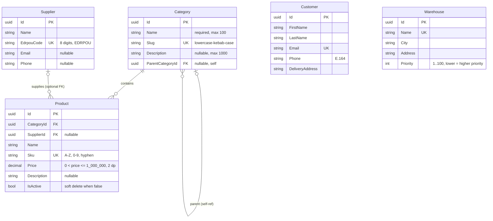
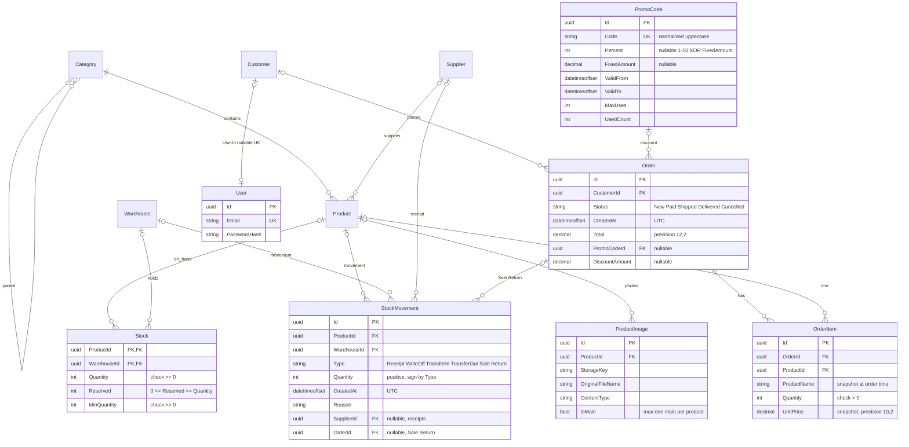

# ERD предметної області (Online Store / Warehouse)

Спільна діаграма сутностей для команди **team-05-store**.

| Джерело | Призначення |
|---------|-------------|
| [TZ.md](TZ.md) §2.2–2.3 | Повна предметна область і зв’язки |
| GitHub issue **#5** | Обов’язковий мінімум для S1 (ЛР1) |
| Issues S2–S8 | REST-контракти, EF, розширення моделі |

Діаграму **оновлюють у PR**, де змінюється модель даних (міграції EF, нові зв’язки). У таких задачах у Acceptance Criteria часто є пункт «ERD оновлено».

**Нотація Mermaid (кардинальність на лінії):** `||` — рівно один; `|o` — нуль або один; `o{` — нуль або багато; `|{` — один або багато. Позначки зліва й справа описують відповідні кінці зв’язку.

---

## Діаграма S1 (закриває issue #5)

П’ять базових сутностей каталогу та довідників. Зв’язки **Category → Product** і **Supplier → Product** узгоджені з TZ §2.3 і майбутніми задачами #30, #31. Назви сутностей на діаграмі збігаються з майбутніми класами C# (`Category`, `Product`, …).



### Зв’язки S1

| Зв’язок | Кардинальність | Delete / примітка |
|---------|----------------|-------------------|
| Category → Category (parent) | 0..1 : N (дерево) | Цикл заборонений (#43); видалення з дочірніми категоріями або товарами → 409 (TZ §2.4, п. 9) |
| Category → Product | 1 : 0..N | **Restrict** — категорію з товарами не видаляють (#30) |
| Supplier → Product | 0..1 : 0..N, FK nullable | **SetNull** на `Product.SupplierId` (#31) |
| Customer | ізольовано на S1 | Зв’язок **Customer → Order** — S4 (#45) |
| Warehouse | ізольовано на S1 | Зв’язок через **Stock** — S4 (#44) |

### Пояснення рішень (S1)

- **Id типу uuid (`Guid` у C#)** — для PostgreSQL, EF Core (S3) і **REST S2**: однаковий тип у in-memory сервісах, DTO, маршрутах і тестах. Перехід з `int` на `Guid` після S2 зламав би контракт API.
- **Category.Slug** — стабільний ідентифікатор у URL/API; унікальний глобально.
- **ParentCategoryId** на діаграмі відповідає TZ; REST/валідація дерева — S4 (#43), не блокує S2 CRUD (#7–#8).
- **Product.IsActive** — soft delete (#38); фізичне видалення товару з історією замовлень не передбачено.
- **Supplier.EdrpouCode** — код ЄДРПОУ (латиниця EDRPOU); те саме ім’я в сутності, DTO і стовпці БД.
- **Warehouse.Priority** — менше значення = вищий пріоритет при резервуванні (TZ §2.4, п. 3).

---

## Цільова модель (TZ §2.2–2.3 + issues S4–S8)

Повна карта сутностей на кінець семестру. Погоджено з викладачем: **дві діаграми в одному файлі** — AC #5 закриває S1, цільова модель підтримується в актуальному стані при змінах схеми.



### Наскрізні механізми (не окремі сутності на діаграмі S1)

| Механізм | Issue / джерело | Вплив на модель |
|----------|-----------------|-----------------|
| **IAuditable** (`CreatedAt`, `UpdatedAt`) | #39 | Поля на ≥3 сутностях; виставляє `SaveChangesInterceptor`, не DTO |
| **Soft delete Product** | #38 | `IsActive` + global query filter; історія замовлень — знімок `OrderItem.ProductName` (#45) |
| **Оптимістична конкурентність Product** | #40 | `Version` / `xmin` на **Product** (одночасне редагування ціни) |
| **Конкурентність Stock (остання одиниця)** | TZ §2.4, п. 4; #51 | `xmin` / `FOR UPDATE` / retry на **Stock** при резервуванні |
| **Унікальні індекси та CHECK** | #29 | Slug, Sku, Email, EdrpouCode, Stock checks (#44) |
| **Файли** | #75, #76 | Бінарник у сховищі; у БД лише метадані `ProductImage` |

### Інваріанти, які команда має тримати узгодженими

1. **Stock**: доступно = `Quantity − Reserved`; резервування при checkout (#50) у порядку `Warehouse.Priority`.
2. **PUT quantity (#44) і журнал (#49):** у S4 PUT може змінювати `quantity` напряму (журналу ще немає). З #49: якщо PUT змінює `quantity`, у **тій самій транзакції** створюється рух на різницю — **Receipt** (збільшення) або **WriteOff** (зменшення), `Reason` = «Інвентаризація»; узгодженість Stock і суми рухів (TZ §2.4, п. 7).
3. **OrderItem.UnitPrice** і **OrderItem.ProductName** — знімки на момент замовлення (погоджено; поза мінімумом TZ, але обґрунтовано для soft delete і історії).
4. **StockMovement.OrderId** — nullable, для типів **Sale** / **Return** (погоджено; traceability, TZ §2.4, п. 5).
5. **PromoCode**: `UsedCount` збільшується в **тій самій транзакції**, що створення Order (#53).
6. **Order.Total** обчислює сервер із позицій і знижки; зберігання в `Order` — кеш для читання, має збігатися з розрахунком у транзакції checkout.

---

## Шари залежностей (огляд)

```text
[Довідники]  Category (дерево), Supplier, Warehouse
      ↓
[Каталог]    Product → Category (обовʼязково), Supplier (опційно)
      ↓
[Склад]      Stock(Product, Warehouse) ← StockMovement (append-only журнал)
      ↓
[Продажі]    Customer → Order → OrderItem → Product; PromoCode → Order (опційно)
[Доступ]     User ↔ Customer (1:1 через Customer.UserId)
[Медіа]      ProductImage → Product
```

Граф **ациклічний**: замовлення не має FK на Stock; резерв і списання — транзакційна логіка в сервісах (#50, #49).

---

## Архітектурні рішення та компроміси

Оцінка моделі щодо TZ §2.2–2.3 і типових практик реляційного проектування (нормалізація, цілісність FK, snapshot-транзакції, розділення профілю й auth).

### Каталог (Category, Product, Supplier)

| Переваги | Недоліки / ризики |
|----------|-------------------|
| Нормалізований каталог; UK на `Slug` і `Sku` | Дерево категорій на `ParentCategoryId` — складні вибірки «все піддерево» без рекурсивного SQL (#43) |
| **Restrict** / **SetNull** узгоджені з TZ §2.3 | Один Product — одна Category (для MVP достатньо) |
| `IsActive` замість DELETE зберігає історію замовлень | Global query filter — компенсуємо знімками на `OrderItem` |

### Склад (Warehouse, Stock, StockMovement)

| Переваги | Недоліки / ризики |
|----------|-------------------|
| **Stock** як асоціативна сутність замість M:N — вимога TZ §2.3 | Поточний залишок і журнал — два представлення; потрібні тести узгодженості (#49) |
| Складений PK `(ProductId, WarehouseId)` — природний ключ | PUT + журнал потребують дисципліни після #49 |
| CHECK на Stock (#44); конкурентність Stock (#51, TZ §2.4 п. 4) | `Reserved` змінюється при checkout — транзакції / блокування |

### Продажі (Customer, Order, OrderItem, PromoCode)

| Переваги | Недоліки / ризики |
|----------|-------------------|
| Знімки `UnitPrice` і `ProductName` — коректна історія чеків | `Total` + позиції + знижка — одне правило в checkout |
| Окрема **PromoCode** — ліміти, період, атомарний `UsedCount` | XOR Percent / FixedAmount — CHECK у БД + `DiscountCalculator` (#53) |
| Order як aggregate root, cascade на Items | Немає таблиці історії статусів (для курсу не вимагається) |

### Ідентичність (Customer, User)

| Переваги | Недоліки / ризики |
|----------|-------------------|
| Профіль (**Customer**) окремо від **User** (Identity) | Два поля email; політика синхронізації (#66) |
| `Customer.UserId` nullable, унікальний — 0..1 : 1 | На ERD **User** спрощений; фізична схема Identity ширша (#62) |

### Файли (ProductImage)

| Переваги | Недоліки / ризики |
|----------|-------------------|
| Метадані в БД, байти в `IFileStorage` (#75) | `IsMain` — partial unique index (#76) |
| Прив’язка до Product, не до Order | Ліміт «до 8 фото» — правило API |

### Модель в цілому

| **Pros** | **Cons** |
|----------|----------|
| Усі сутності TZ покриті | Identity на діаграмі спрощений порівняно з ASP.NET Identity |
| Чіткий порядок впровадження по спринтах | Guid PK — більші індекси (для курсу прийнятно) |
| Кардинальність на діаграмах узгоджена з nullable FK | Цільову діаграму треба оновлювати разом із міграціями |

**Нормалізація:** довідники й Stock — орієнтовно 3NF; навмисна денормалізація на `Order` / `OrderItem` для незмінної історії продажів.

---

## Погоджені рішення (викладач, PR #91)

| Тема | Рішення |
|------|---------|
| Дві діаграми в одному файлі | Погоджено: S1 для AC #5, цільова — за умови підтримки в актуальному стані |
| PUT `quantity` (#44) + журнал (#49) | S4: PUT змінює quantity без журналу; з #49: різниця → Receipt/WriteOff, Reason «Інвентаризація» |
| `OrderItem.ProductName` | Погоджено (знімок після soft delete товару) |
| `StockMovement.OrderId` | Погоджено (nullable, Sale / Return) |
| Тип `Id` | **Guid** уже в S2 in-memory і в API |

---

## Еволюція ERD по спринтах

| Спринт | Issues (приклад) | Що додається / змінюється в ERD |
|--------|------------------|----------------------------------|
| **S1 · ЛР1** | **#5** | `docs/erd.md`, діаграма 5 сутностей (цей документ) |
| **S2 · ЛР2** | #7–#16 | Поля DTO узгоджуються з таблицями вище; **Guid** у контрактах |
| **S3 · ЛР3** | #17–#26, #27, #28 | `DbSet`, EF-конфігурації, перші міграції для 5 сутностей |
| **S4 · ЛР4** | #29, #30, #31, #38–#40, #43–#45 | Зв’язки FK, **Stock**, **Order** / **OrderItem**, аудит, індекси |
| **S5 · ЛР5** | #49–#54, #55 | **StockMovement**, checkout, **PromoCode**, статуси замовлення |
| **S7 · ЛР7** | #62–#66 | **User** (Identity), `Customer.UserId` |
| **S8 · ЛР8** | #75–#76 | **ProductImage**, файлове сховище |

Задачі з явною вимогою **«ERD оновлено»** в AC (перевіряти при merge): **#30**, **#44**, **#45**; аналогічно варто оновлювати документ у **#31**, **#49**, **#53**, **#66**, **#76**.

---

## Статус погодження

- [x] Дві діаграми, PUT/journal, `ProductName`, `OrderId` — погоджено викладачем (коментар у PR #91)
- [x] Requested changes: кардинальність Mermaid, синтаксис полів, `EdrpouCode`, наскрізні механізми, `Guid` у S2 — виправлено на гілці `feat/5/erd`
- [ ] Повторний **Approve** викладача на актуальному head після виправлень (peer: Danyleichuk-Vladyslav)
